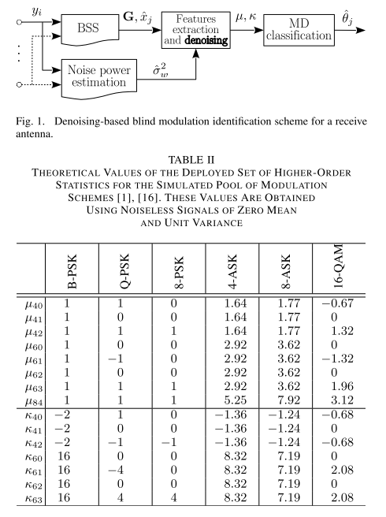
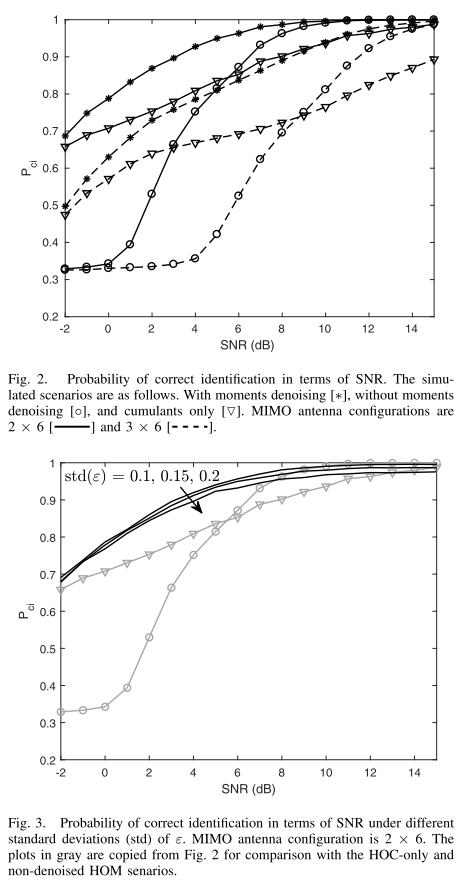
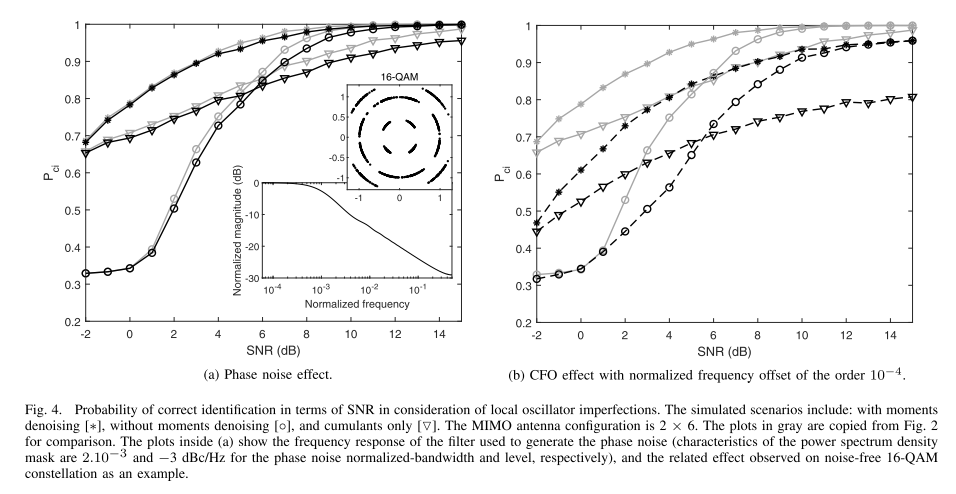

# [Modulation Identification] High-Order Moments Denoising Method for Digital Modulation Blind Identification in Multi-Antenna Systems [with MATLAB Code]

Introduction With the continuous rapid development of intelligent communication systems, signal detection has always been a critical issue to consider. In intelligent transmissions such as cognitive radio, signal detection is no longer limited to detecting energy; it extends beyond, for example, demodulation of unknown signals and recognition of modulation. When the source signal and channel parameters are unknown, we are in a blind environment, naturally necessitating a blind modulation recognition process. Despite their high recognition accuracy, maximum likelihood-based techniques used for modulation recognition often suffer from considerable complexity. Feature-based algorithms for modulation recognition offer an alternative, providing good performance and a balance between complexity and efficiency.
Higher-order statistics (HOS) serve as low computational complexity features and are widely applied in digital modulation identification (MIMO) [1]-[8]. Higher moments (HOM) and higher cumulants (HOC) have shown good recognition performance [1]-[8]. In this context, employed HOS estimate noise observations. The estimated HOC is less sensitive to noise than the estimated HOM [9]. Therefore, most SVM algorithms based on HOS rely on HOC as a feature [1]-[8]. However, many other recursive algorithms based on HOS attempt to improve recognition performance by including a set of HOMs [2]-[4], [6].
Due to the extensive discussion of blind estimation of noise power in the literature, we consider denoising the estimated HOM. The primary contribution of this letter is to further improve the performance of a reconfigurable system by using an un-noised HOM as part of the HOS. Additionally, to enhance the blindness, we use a classifier that does not require prior training. Furthermore, within the framework of this letter, we believe that MIMO systems are one of the most advanced wireless systems. Moreover, multi-input multi-output (MIMO) systems have been extensively covered in the literature [2]-[6], [8], [10]-[13]. To our knowledge, no one has attempted to counteract the noise in the HOM in a blind environment. More specifically, the contributions of this letter are threefold: (i) the derivation of the un-noised HOM formula for baseband digital modulation signals, which in turn requires the derivation of the HOM formula for complex-valued Gaussian noise; (ii) integration of denoising methods into MIMO systems. It allows for the un-noised HOM to be applied to each receive antenna considering the effect of source separation processing; and (iii) the denoising technique improves recognition accuracy under various receiver damage effects while maintaining the same complexity order for MIMO systems.
Conclusions In conclusion, after deriving the noiseless moment, simulation results prove that denoising modulation detection is more effective than classical detection processes (such as those based on HOC and other non-denoising moments) through denoising. Moreover, since it does not assume specific SNR values, the proposed denoising method is also applicable to hierarchical classification. Regarding complexity, the additional operations related to the denoising term have a constant time complexity. Additionally, since the evaluated recognition schemes are based on similar [2], [4] schemes, they follow the same complexity order (both having polynomial running times), thus our suggested outstanding performance is achieved with the same computational complexity order in MIMO channels. More generally, for any HOS-based denoising algorithm employing denoising HOM, its assumption of prior knowledge of noise power or consideration of its estimation (e.g., [2], [4], [12]) improves recognition accuracy without increasing computational complexity or at least its order.

## Images

<!-- PAYMENT_BLOCK -->

## Get this dataset

- Payment link (Stripe): [Buy now](https://buy.stripe.com/3cs8yP7sY87d0vu9AB)
- Payment QR code: 

<!-- /PAYMENT_BLOCK -->
